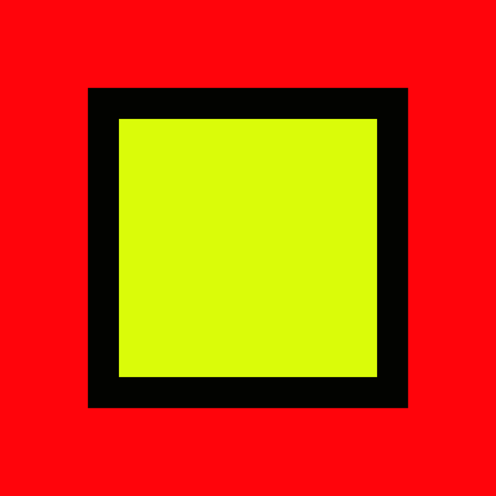

# R-RAD Studio

<p align="center">
  
</p>

<p align="center">
  <strong>R Rapid Application Development & Statistical GUI</strong><br />
  <em>The Extensible, Modern, Open-Source Statistical Workbench Powered by R, Tauri, and Svelte</em>
</p>

<p align="center">
  
  
  
  
  
</p>

---

## 💡 What is R-RAD Studio?

For decades, researchers, biostatisticians, social scientists, students, and data practitioners have relied on classic point-and-click statistical packages (such as IBM SPSS Statistics) for their intuitive, accessible workflows. However, proprietary suites are burdened by exorbitant licensing costs, closed ecosystems, and rigid extensibility.

On the other hand, the **R statistical programming language** is the world's most powerful, vibrant, and peer-reviewed ecosystem for data analysis—yet its command-line barrier keeps millions of potential users locked out.

**R-RAD Studio bridges these two worlds.** It delivers the immediate, comfortable point-and-click experience of classic statistical suites, backed by the raw power, flexibility, and transparency of modern R.

---

## ✨ Unique Capabilities

### 1. 🧩 "Everything is a Form Schema"
Unlike traditional software with hardcoded dialog boxes, **100% of statistical procedures in R-RAD Studio are declarative JSON Form Schemas (`.rform.json`)**.
- The user interface is decoupled from the statistical logic.
- Adding a new statistical procedure or customizing an existing one requires **zero recompilation** and zero knowledge of Rust, C++, or JavaScript.

### 2. 🎨 In-App Visual RAD Designer (VB6 / Qt Designer Paradigm)
Switch any statistical dialog into **Design Mode** with a single click:
- Drag-and-drop statistical widgets (variable pickers, target slots, checkboxes, radio options, dropdowns, numeric steppers, and tabbed subdialogs) onto a 12-column responsive layout.
- Bind form controls to a Handlebars R template.
- Save your custom dialog directly into the `modules/` folder—it immediately mounts into the desktop menu bar with live hot-reloading!

### 3. 📂 Dynamic Folder Hierarchy in `modules/`
R-RAD Studio organizes its **Analyze** menu directly from the directory structure of the `modules/` directory:
- Create a folder named `modules/Compare Means/` or `modules/Psychometrics/Item Analysis/`.
- The folder name automatically becomes the menu category and subcategory label in the application.
- Users and research labs can organize their modules and analysis pipelines however they like.

### 4. 📜 Reproducible Transparency: The "Paste" Paradigm
Every analysis dialog includes both an **[ OK ]** button and a **[ Paste ]** button:
- **[ OK ]:** Runs the analysis immediately on the persistent background R daemon and streams publication-ready tables and graphs to the Output Viewer.
- **[ Paste ]:** Compiles clean, idiomatic R syntax (utilizing modern packages like `tidyverse`, `broom`, `gt`, and `ggplot2`) and pastes it into the built-in **Syntax Editor**. Your analyses are always 100% reproducible and verifiable.

### 5. 📊 Interactive Browser-Native Output Viewer
- Results are rendered as clean, modern HTML tables and crisp vector graphics (`SVG`).
- **Interactive Outline Tree:** Instantly jump to any output block or log entry.
- **Copy-to-Clipboard:** Copy styled tables directly into Microsoft Word, Google Docs, LibreOffice, or Microsoft Excel with formatting and typography intact.

### 6. 🗂️ Dual Data Grid with Full Spreadsheet Capabilities
- **Data View:** Fast virtualized grid with measurement-level indicators (📐 Scale, 📊 Ordinal, 🔵 Nominal).
- **Variable View:** Comprehensive data dictionary to edit variable names, descriptive labels, measurement levels, and categorical value mappings.
- **Full Spreadsheet Operations:** In-place cell editing, arbitrary row insertion/deletion, Excel/Google Sheets clipboard interoperability (TSV copy-paste), and a multi-featured Find & Replace tool.

### 7. 🛡️ Forgiving Undo/Redo & Crash Safety Architecture
Data safety is treated with the highest engineering priority:
- **30-Level Snapshot History:** Effortlessly undo (`Ctrl+Z`) and redo (`Ctrl+Y`) major mutations—including batch pastes, formula calculations, row deletions, and cell edits—without risk of data loss.
- **Atomic POSIX Checkpointing:** Every data modification is automatically written to an atomic disk checkpoint (`checkpoint.rds`) using temporary staging and atomic replacement.
- **Emergency Disaster Recovery:** In the event of an abrupt hardware failure or power outage, select **Edit $\rightarrow$ Restore from Emergency Checkpoint...** to instantly rescue your dataset.
- **100% Safe Rust Guarantee:** Built on Tauri v2 with zero `unsafe` Rust blocks across the entire backend.

### 8. 🌐 Comprehensive Multi-Format Interoperability
Open, import, and export seamlessly across all key data formats:
- **SPSS Datasets (`.sav`)** with full metadata, measurement types, and value dictionaries
- **OpenDocument Spreadsheets (`.ods`)** via native ODF standards
- **Microsoft Excel (`.xlsx`, `.xls`)**
- **Comma-Separated Values (`.csv`)**
- **Serialized R Data Frames (`.rds`)**
- **R-RAD Open Project Bundles (`.rrad`)** preserving active datasets, syntax history, and complete output streams in an open JSON format

---

## 🤝 An Open Invitation: Join the Project!

**R-RAD Studio is built by and for the global research, statistical, and open-source community.**

We believe that data analysis tools should be free, transparent, reproducible, and accessible to everyone regardless of programming proficiency. To achieve this, **we invite researchers, statisticians, biostatisticians, R package authors, and developers worldwide to join the project!**

### 🌟 How You Can Contribute

#### 1. Author New Statistical Modules (No Web Coding Required!)
If you know R, you can turn any statistical procedure or CRAN package into a point-and-click GUI module in minutes!
- Define an `.rform.json` schema and an R Handlebars template.
- Place it in `modules/<Category>/<ProcedureName>.rform.json`.
- It will automatically appear in R-RAD Studio's menu.

> **💡 AI-Assisted Authoring:** You can even use an LLM (such as Claude, ChatGPT, or Gemini) to generate modules for you! We provide a complete step-by-step prompt template in [RAD Developer Guide](docs/RAD_GUIDE.md) that converts any R function into a production-ready `.rform.json`.

#### 2. Statistical Domains Waiting for Modules
We are actively looking for contributors to expand our module catalog across:
- **Psychometrics & Survey Analysis:** Cronbach's Alpha, Exploratory Factor Analysis (EFA), Confirmatory Factor Analysis (CFA), Item Response Theory (IRT), Likert scales.
- **Advanced Regression & Modeling:** Binary/Multinomial Logistic Regression, Poisson, Negative Binomial, Generalized Additive Models (GAM), Multilevel / Mixed-Effects Models (`lme4`).
- **Biostatistics & Clinical Trials:** Survival Analysis (Kaplan-Meier, Cox Proportional Hazards via `survival`), Odds Ratios, Relative Risk, Diagnostic Tests & ROC curves (`pROC`).
- **Multivariate Statistics & Machine Learning:** Principal Component Analysis (PCA), Cluster Analysis (K-Means, Hierarchical), Random Forests, Decision Trees.
- **Non-Parametric Methods:** Mann-Whitney U, Wilcoxon Signed-Rank, Kruskal-Wallis, Friedman, Chi-Square Goodness-of-Fit.
- **Meta-Analysis:** Effect size calculation, Fixed & Random Effects models, Forest plots, Funnel plots (`metafor`).
- **Econometrics & Time Series:** ARIMA, Seasonal Decomposition, Granger Causality, Vector Autoregression (`forecast`).

#### 3. Core Development & Translation
- **Rust / Tauri Developers:** Performance profiling, Arrow streaming, cloud sync integrations.
- **Frontend / Svelte Developers:** UI refinements, accessibility, chart customizers, themes.
- **Translators:** Help localize R-RAD Studio dialogs and guides into multiple world languages.

---

## 🚀 Getting Started

### Prerequisites
1. **Node.js** (v18 or higher) & **pnpm** (or `npm`)
2. **Rust & Cargo** (v1.75 or higher)
3. **R** (v4.2 or higher) with core packages installed:
   ```R
   install.packages(c("jsonlite", "haven", "readxl", "writexl", "readODS", "gt", "broom", "svglite"))
   ```

### Running Locally in Development Mode
```bash
# Clone the repository
git clone https://github.com/your-username/r_rad_studio.git
cd r_rad_studio

# Install frontend dependencies
npm install

# Launch R-RAD Studio in development mode
npm run tauri dev
```

### Building Release Package
```bash
# Compile native binary and platform bundle (AppImage/deb on Linux, exe/msi on Windows, dmg on macOS)
npm run tauri build
```

---

## 📚 Documentation & Resources

- 📖 **[User Guide](docs/USER_GUIDE.md):** Complete manual covering data grid navigation, spreadsheet editing, formula calculation, analysis execution, and report exporting.
- 🛠️ **[RAD Developer & AI Authoring Guide](docs/RAD_GUIDE.md):** Architectural specification, 12-column widget reference, Handlebars R templating rules, and ready-to-use AI prompts for generating modules.
- 📐 **[Master Engineering Specification](PROJECT_SPEC_.md):** Architectural directives, multi-agent contracts, and core design tenets.

---

## 📄 License

This project is licensed under the [MIT License](LICENSE). Join us in making statistical computing transparent, beautiful, and accessible to everyone!
